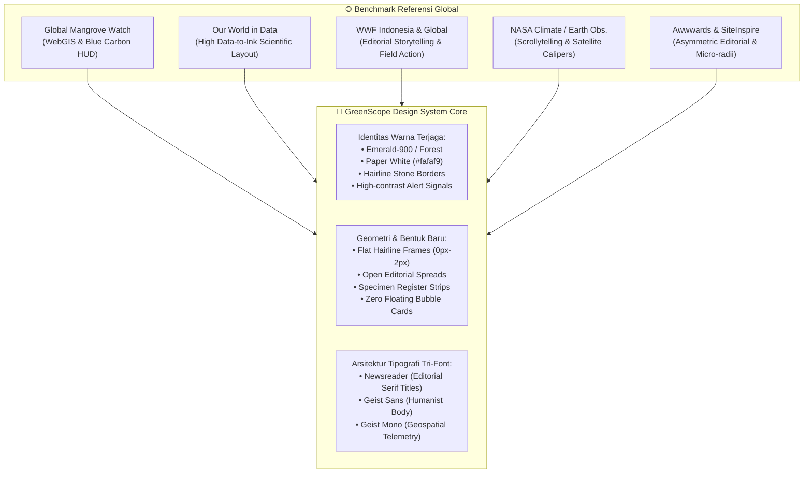

# GreenScope: Design Reference & Benchmark Analysis
### Transformasi Arsitektur Desain: Scientific Editorial + Environmental Cartography

**Dokumen:** `DESIGN_REFERENCE_ANALYSIS.md`  
**Peran:** Principal UI/UX Designer, Creative Art Director, & Motion Design Engineer  
**Proyek:** GreenScope — Platform Konservasi Pesisir dan Hutan Tropis Bengkulu  
**Status:** Panduan Referensi Desain & Pola Interaksi (Non-Code Modification)  

---

## 1. Executive Summary & Creative Direction

GreenScope adalah platform pemantauan lingkungan dan mobilisasi restorasi bentang alam yang berfokus pada ekosistem pesisir (sabuk mangrove, pantai abrasi, muara) dan koridor hutan tropis Bukit Barisan di Bengkulu. 

Tantangan utama yang dihadapi sebelumnya adalah kecenderungan antarmuka digital yang terjebak dalam **"AI-Generated Dashboard Slop"**:
* Penggunaan kartu (*card*) dan kotak (*container*) membulat (*rounded-2xl*) yang repetitif di seluruh halaman.
* Efek transparan berlebih (*glassmorphism*, `backdrop-blur-md`, dan gelembung hijau `bg-emerald-50`).
* Tipografi yang kaku dan seragam karena hanya mengandalkan sans-serif netral tanpa ekspresi editorial.
* Tombol-tombol bulat berwarna permen pekat (*candy pill buttons*) yang mengurangi kredibilitas ilmiah platform.

### Arah Solusi: *Scientific Editorial + Environmental Cartography*
Mengacu pada mandat desain: **"Hanya ubah tata letak, ukuran, dan bentuk; warna tetap pertahankan identitas GreenScope (deep emerald, forest green, paper-cream background, dan aksen bahaya/waspada yang fungsional)."**

Dokumen ini membedah 6 domain referensi kelas dunia untuk mengekstraksi prinsip desain, proporsi *whitespace*, geometri bentuk, tata letak data, dan fisika gerak (*motion physics*) yang diaplikasikan ke GreenScope.



---

## 2. Analisis Mendalam Entitas Referensi

### 2.1. Global Mangrove Watch (`globalmangrovewatch.org`)
*Fokus GreenScope: ScopeMap WebGIS, Daftar Lokasi Kritis, Lapisan Biomassa Karbon Biru.*

* **Visual Identity & Mood:** Bersih, berwibawa, teknis namun mudah diakses publik. Tidak ada ornamen dekoratif non-fungsional. Estetika laboratorium kartografi modern.
* **Layout Composition:** *Map-first canvas*. Peta mendominasi 100% viewport, sedangkan kontrol navigasi, filter, dan legenda disajikan sebagai modul melayang (*HUD overlay*) yang sangat terukur.
* **Penggunaan Card & Container:** 
  * Menghindari kartu tebal dengan bayangan berat.
  * Menggunakan *drawer* samping (*slide-over panel*) yang ramping dengan batas garis tipis (*hairline 1px border*) untuk menampilkan data agregat suatu wilayah mangrove tanpa menutupi titik pengamatan di peta.
* **Visualisasi Data Lingkungan:**
  * Menampilkan degradasi vs pemulihan melalui lapisan warna bergradasi tegas (merah/oranye untuk kehilangan/abrasi, hijau tua untuk tutupan kanopi stabil, hijau mint untuk sabuk restorasi).
  * Menampilkan statistik biomassa (*Aboveground Biomass / Soil Organic Carbon*) dengan angka tegas, satuan eksplisit ($t\,\text{CO}_2e/\text{ha}$), dan interval kepercayaan data.
* **Pelajaran untuk GreenScope:**
  * Ubah tampilan `ScopeMap WebGIS` di `/peta` dan Step 3 Scrollytelling menjadi *Cartographic Inspection View*.
  * Hapus container pil bulat pada legenda dan ganti dengan register indeks koordinat yang terstruktur rapi.

---

### 2.2. Our World in Data (`ourworldindata.org`)
*Fokus GreenScope: Kalkulator Karbon Biru, Statistik Kerusakan, Metrik Dashboard.*

* **Visual Identity & Mood:** Ilmiah, objektif, netral, mengedepankan integritas data (*high data-to-ink ratio* sesuai prinsip Edward Tufte).
* **Layout Composition:** *Open Editorial Spread*. Informasi tidak dikurung dalam puluhan kotak kecil, melainkan mengalir secara hierarkis di atas kanvas terbuka dengan garis pemisah rambut (*hairline divider*).
* **Typography:**
  * Judul artikel dan metrik menggunakan Serif elegan dengan *letter-spacing* natural.
  * Angka data menggunakan font dengan fitur *tabular lining figures* (angka memiliki lebar tetap sehingga sejajar secara vertikal dan tidak bergoyang saat nilai berubah).
* **Penggunaan Whitespace:** Sangat leluasa (*generous whitespace*). Ruang kosong digunakan secara sengaja untuk memisahkan bab analisis, bukan pembatas border tebal.
* **Visualisasi & Kontrol Interaktif:**
  * Slider kalkulasi menyatu secara horizontal (*flush caliper scale*).
  * Tidak ada kartu ganda di dalam kartu (*zero card-in-card nesting*). Angka hasil perhitungan ditampilkan ekstra besar (48px–64px) langsung di sisi kanan dengan penjelasan metodologis di bagian bawah.
* **Pelajaran untuk GreenScope:**
  * Terapkan pola ini pada **Kalkulator Biomassa Karbon Biru** di Beranda.
  * Hilangkan kotak gelap tertutup sebelumnya; biarkan slider rentang target bibit dan metrik serapan karbon tahunan ($5.350\,\text{kg CO}_2e/\text{th}$) tampil sebagai lembar data terbuka yang prestisius.

---

### 2.3. WWF Indonesia (`wwf.id`) & WWF International
*Fokus GreenScope: Landing Page Hero, Narasi Konservasi Lapangan, Aksi Relawan.*

* **Visual Identity & Mood:** Menggugah (*urgent*), berbasis lapangan (*grassroots-driven*), membumi, dan berorientasi pada manusia serta keanekaragaman hayati riil.
* **Layout Composition:**
  * Komposisi Hero asimetris: Judul besar di satu sisi, dipadukan dengan fotografi jurnalistik lapangan berkualitas tinggi (bukan grafis 3D atau mockup sintetis).
  * Menampilkan lokalisasi bentang alam yang spesifik (misal Pesisir Barat Sumatera, Teluk Bengkulu).
* **Navigasi & Menu:**
  * Bersih, kokoh, berorientasi aksi langsung (*Call to Action* jelas: Laporkan, Dukung, Ikuti Aksi).
  * Menu aktif tidak menggunakan pil hijau membulat transparan, melainkan tipografi tegas dengan penanda garis bawah (*underline rule*).
* **Pola Kampanye Aksi:**
  * Mengelompokkan program konservasi berdasarkan urgensi lapangan dan keterlibatan komunitas lokal.
  * Transparansi logistik: apa yang dibutuhkan relawan, spesies apa yang ditanam, dan target dampak ekologisnya.
* **Pelajaran untuk GreenScope:**
  * Gunakan prinsip dokumenter WWF pada Hero Section dan halaman `/aksi`.
  * Ganti tombol permen tebal dengan tombol bergaris tegas dan jelas. Pastikan foto lapangan menampilkan bentang alam pesisir dan satwa/flora endemik Sumatera secara autentik.

---

### 2.4. NASA Climate / Earth Observatory & Mapbox Storytelling
*Fokus GreenScope: Scrollytelling Interaktif 5-Fase, Slider Before/After Restorasi.*

* **Visual Identity & Mood:** *Precision Telemetry*. Nuansa observatorium bumi canggih dengan koordinat garis lintang/bujur, waktu observasi, dan indeks anomali satelit.
* **Pola Scrollytelling:**
  * **Viewport Terpancang (*Sticky Pinning*):** Kolom visual (peta atau dosir bukti) tetap terkunci di layar saat pengguna menggulir (*scroll*), sementara narasi penjelasan mengalir bergantian di sisi yang berlawanan.
  * **Indikator Progres Fase:** Menggunakan skala numerik tipis (`FASE 01 / 05`) dengan baris progres horizontal, bukan titik bulat navigasi (*carousel dots*) generik.
* **Interaksi Split-Screen Slider (Before vs After):**
  * Membagi kondisi awal degradasi (limbah/abrasi) dengan kondisi pasca pemulihan melalui garis pemisah tipis 1px dengan pegangan (*handle*) geometris minimalis.
  * Bebas dari bayangan tebal atau border mengambang; gambar menempati bingkai penuh secara presisi.
* **Pelajaran untuk GreenScope:**
  * Transformasikan komponen `Scrollytelling` di Beranda GreenScope agar menyajikan alur tertutup (*Closed-Loop Conservation*) layaknya jurnal misi ekspedisi sains NASA.
  * Tampilkan metadata telemetri GPS (`3°48'56.2"S, 102°15'32.4"E`) sebagai elemen antarmuka yang terintegrasi di bagian atas gambar, bukan stiker melayang.

---

### 2.5. MapBiomas Indonesia & Global Forest Watch
*Fokus GreenScope: Klasifikasi Tutupan Ekosistem, Antrean Verifikasi Koordinator di Dashboard.*

* **Visual Identity & Mood:** Analitis, berorientasi spasial, data tutupan lahan berlapis (*time-series satellite land cover*).
* **Tabel & Antrean Verifikasi:**
  * Menggunakan sistem baris data tabular dengan pemisah rambut (*hairline borders*).
  * Indikator status keparahan tidak menggunakan badge gelembung warna permen, melainkan *status dot* presisi (`● KRITIS`, `▲ SEDANG`, `✓ PULIH`) dengan teks monospaced.
  * Tombol verifikasi tidak berukuran raksasa, melainkan tautan fungsional presisi yang terintegrasi dalam baris tabel.
* **Pelajaran untuk GreenScope:**
  * Format ulang **Panel Status Darurat Ekosistem** dan **Tabel Antrean Verifikasi Lapangan** di `/dashboard`.
  * Jadikan antrean laporan warga tersaji sebagai register inspeksi lapangan yang bersih, cepat dipindai (*scannable*), dan profesional.

---

### 2.6. Awwwards, SiteInspire, & One Page Love (Stripe Climate, Patagonia Action Works)
*Fokus GreenScope: Hierarki Whitespace, Radius Sudut, Bentuk Komponen, & Mikro-interaksi.*

* **Karakteristik Anti-AI-Slop:**
  * Menolak *border-radius* ekstrem (tidak ada `rounded-2xl` atau `rounded-3xl` pada elemen fungsional).
  * Menggunakan *micro-radii* (0px atau 2px), menciptakan karakter editorial yang presisi, tegas, dan berkelas tinggi.
  * Mengganti kartu berlapis (*nested cards*) dengan struktur garis pemisah (`border-t`, `border-b`, `divide-y`).
  * Interaksi tombol menggunakan pergeseran teks tipis atau panah tipografis (`➔`), bukan animasi gelembung melompat-lompat.
* **Pelajaran untuk GreenScope:**
  * Standarisasi seluruh container menjadi persegi bergaris halus (`rounded-none` atau `rounded-xs`).
  * Ciptakan rasa kemewahan (*refinement*) melalui kualitas tipografi dan proporsi bidang, bukan melalui bayangan (*drop-shadow*) atau efek blur transparan.

---

## 3. Matriks Komparasi 7 Dimensi Arsitektur Desain

| Dimensi | Pola Lama (Generic AI Dashboard) | Benchmark Referensi Global | Standar Baru GreenScope |
| :--- | :--- | :--- | :--- |
| **1. Visual Direction** | Template SaaS techy, warna neon melayang, cards repetitif, kesan generator instan. | *Scientific Editorial + Environmental Cartography* (GMW, OWID, WWF, NASA). | Platform observatorium lingkungan berbasis sains & aksi warga Bengkulu; berwibawa, otentik, membumi. |
| **2. Layout & Composition** | Tata letak kotak-kotak simetris 4 kartu seragam, padding sempit, elemen terkurung box. | Komposisi asimetris, bidang terbuka (*open spreads*), hierarki skala besar-kecil jelas (Awwwards/OWID). | Tata letak editorial terbuka; Hero asimetris (teks 7 col vs dosir 5 col); kalkulator tabular tanpa bungkus box; dashboard komando terstruktur. |
| **3. Typography** | Sans-serif tunggal seragam (Geist), semua tebal (*bold/black*), monoton dan kaku. | Kombinasi Serif literatur klasik + Sans humanist + Monospace telemetri (OWID/NASA). | **Newsreader Serif** untuk judul prestisius; **Geist Sans** untuk teks badan; **Geist Mono** untuk koordinat & metrik data. |
| **4. Whitespace & Density** | Ruang kosong minim, kartu dijejalkan berdampingan, padding internal sempit dan claustrophobic. | Whitespace lapang bertindak sebagai pemisah alami (*intentional breathing room*) (SiteInspire). | Jarak vertikal teratur (`py-16`, `py-20`), pemisah garis rambut halus 1px slate-200/stone-300 menggantikan balok kontainer. |
| **5. Card & Container** | Hampir semua komponen dibungkus kartu `rounded-2xl shadow-md border bg-white/95`. | Kontainer fungsional saja; tabel terbuka; strip spesimen; drawer geser; 0px/2px radius (GMW/Awwwards). | Zero card-in-card nesting; kartu hanya untuk dosir visual dan drawer peta; eliminasi seluruh efek sudut membulat berlebih. |
| **6. Navigation & HUD** | Navbar transparan blur dengan kapsul hijau tebal pada tautan aktif; mobile bar mengambang. | Header solid natural paper, tautan aktif bergaris bawah presisi; navigasi mobile ter-dock (WWF/NASA). | Latar `#fafaf9` solid; active state `border-b-2 border-emerald-800`; mobile bottom bar menempel kokoh di dasar layar. |
| **7. Data Visualization** | Angka kecil dalam kotak kecil dengan ikon mengambang tanpa skala referensi. | Angka raksasa (*hero stat*), skala kaliper horizontal, label taksonomi botani eksplisit (OWID). | Angka biomassa monospaced ekstra besar (`text-6xl tabular-nums`), kaliper slider presisi, anotasi standar IPCC. |

---

## 4. Rekomendasi Tata Letak, Ukuran, & Bentuk (Berdasarkan Bagian GreenScope)

Mengikuti instruksi utama: **Warna tetap menggunakan identitas hijau zamrud, paper-white, dan slate GreenScope; fokus perubahan ada pada tata letak, proporsi ukuran, bentuk geometri, dan pola interaksi.**

### 4.1. Header & Navigasi (Desktop & Mobile)
* **Referensi:** WWF Indonesia, NASA Mission Header.
* **Bentuk & Geometri:**
  * Hapus `backdrop-blur-md` dan `rounded-xl` pada active link.
  * Jadikan bilah navigasi solid paper `#fafaf9` dengan border bawah 1px solid `border-stone-300`.
  * Tautan aktif: Hilangkan kapsul hijau `bg-emerald-50`. Ganti dengan tipografi monospaced kapital bergaris bawah rambut (`border-b-2 border-emerald-800 text-stone-900 font-bold`).
* **Ukuran & Spacing:**
  * Ketinggian desktop: `h-16 sm:h-20`, padding horizontal `px-4 sm:px-8`.
  * Brand Logo: Ikon daun persegi tajam 36x36px (`rounded-none bg-emerald-900 text-emerald-200`) dipadukan dengan teks Serif `GreenScope`.
* **Mobile Docked Bar:**
  * Hilangkan bilah pil melayang dengan bayangan besar.
  * Buat bilah dok permanen di dasar viewport (`fixed bottom-0 inset-x-0 h-14 bg-[#fafaf9] border-t border-stone-300`).

---

### 4.2. Hero Section (Panggung Nusantara)
* **Referensi:** Awwwards, WWF Indonesia, Recent Environmental Exhibits.
* **Tata Letak & Komposisi:**
  * Asimetris 12-kolom: Kolom kiri (7 kolom) untuk narasi editorial, kolom kanan (5 kolom) untuk dosir fotografi lapangan.
  * Overline Telemetri: Baris tipis kecil `SISTEM INFORMASI GEOSPASIAL & PRESERVASI EKOLOGI BENGKULU` dengan garis horizontal penunjuk 20px.
* **Tipografi & Ukuran:**
  * Judul Utama (H1): Menggunakan `font-serif` dengan ukuran responsif `text-2xl sm:text-4xl lg:text-5xl` dan *line-height* `1.18`. Hindari pemotongan kata secara acak pada mobile.
  * Subtitle: Paragraf bernapas leluasa berukuran 16px–18px, dengan istilah teknis (*Closed-Loop Conservation*) dicetak miring (*italic serif*).
* **Bentuk Tombol (CTA):**
  * Ubah tombol kapsul bulat menjadi tombol persegi panjang kartografi tegas (`rounded-none px-5 py-3.5 text-xs font-mono uppercase tracking-wider`).
  * Tombol primer: `bg-emerald-900 text-white hover:bg-emerald-950`.
  * Tombol sekunder: `bg-white border border-stone-400 text-stone-900 hover:bg-stone-100`.
* **Dosir Visual Lapangan:**
  * Bingkai foto rasio 4:3 persegi tajam (`rounded-none border border-stone-300`).
  * Header plat telemetri terintegrasi di bagian atas foto dengan koordinat lintang/bujur presisi monospaced dan label `● TERVERIFIKASI`.

---

### 4.3. Interactive Scrollytelling (5 Fase Konservasi Tertutup)
* **Referensi:** NASA Climate Eyes on the Earth, Mapbox Interactive Storytelling.
* **Tata Letak & Pacing Gerak:**
  * Panjang jalur scroll vertikal terkalibrasi (`h-[320vh]`) dengan kontainer pandang lengket (*sticky viewport* `position: sticky; top: 5rem; h-[calc(100vh-5rem)]`).
  * Sisi Kiri: Narasi progresif dengan penomoran fase editorial (`FASE 01 / 05`), judul `font-serif`, dan tautan teks tipografis bergaris bawah (`Pelajari Diagnosis Lapangan ➔`).
  * Sisi Kanan: Dosir artefak konservasi yang berganti secara mulus mengikuti fase (Fase 1: Foto bukti warga ber-GPS; Fase 2: Kartu taksonomi botani; Fase 3: Lembar register spasial; Fase 4: Action brief logistik; Fase 5: Sertifikat audit serapan karbon).
* **Bentuk & Ukuran Artefak:**
  * Hilangkan kartu raksasa pembungkus luar (`rounded-2xl shadow-md p-6`).
  * Wadah artefak menggunakan garis tepi tunggal 1px persegi tajam (`rounded-none border border-stone-300 bg-white p-5`).
  * Komponen dalam dosir dirancang layaknya formulir lapangan resmi (*Field Incident Report Sheet*).

---

### 4.4. Before vs After Restoration Slider
* **Referensi:** NASA Earth Observatory Satellite Comparison.
* **Bentuk & Tata Letak:**
  * Bingkai foto sinematik rasio 16:9 atau 21:9 dengan sudut tajam (`rounded-none border border-stone-300`).
  * Batang geser (*handle divider*): Garis vertikal 1px putih dengan pegangan kontrol persegi tipis berukuran 28x28px (`rounded-none bg-white border border-stone-400 font-mono text-xs`).
  * Label penanda: Sudut kiri bawah menampilkan kondisi awal (`Awal: Timbunan Sampah & Abrasi`), sudut kanan bawah menampilkan kondisi pulih (`Pulih: Sabuk Pesisir Asri`) menggunakan badge persegi monospaced berlatar gelap transparan tipis.

---

### 4.5. Kalkulator Karbon Biru & Biomassa
* **Referensi:** Our World in Data (OWID Interactive Data Pages).
* **Tata Letak:**
  * *Open Scientific Spread* dengan tema malam hutan gelap (`bg-[#071d17] text-white`).
  * Tidak menggunakan kartu-kartu kecil mengambang.
  * Kolom Kiri: Narasi potensi serapan mangrove pesisir Sumatera dipadukan dengan *caliper scale slider* interaktif.
  * Kolom Kanan: Lembar pembacaan metrik tahunan dengan angka monumental (`text-6xl sm:text-7xl font-mono tabular-nums`) dan baris tabel data ekuivalensi yang dipisahkan garis rambut halus `divide-y divide-emerald-900/60`.
* **Bentuk Slider:**
  * Track slider datar minimalis 6px tanpa kurva melingkar tebal.
  * Label batas bawah/atas disajikan dengan garis vertikal skala kaliper (`| 50 Bibit`, `| 500 Bibit`, `| 1.000 Bibit`).
  * Catatan koefisien alometrik spesies (*Rhizophora apiculata* 12,5 kg $\text{CO}_2e$/pohon/tahun) dicantumkan di bagian bawah sebagai rujukan ilmiah transparan.

---

### 4.6. ScopeMap WebGIS & Daftar Titik Kritis
* **Referensi:** Global Mangrove Watch, Mapbox Cartography Engine.
* **Tata Letak:**
  * Bilah filter atas ringkas: Tinggi hanya 48px, menggunakan kontrol select persegi berfont mono (`rounded-none border border-stone-300 text-xs font-mono`).
  * Kanvas peta penuh dengan layer tiles OpenStreetMap detail tinggi yang bebas dari watermark blokade API key.
* **Drawer Inspeksi Titik Lapangan (Slide-Over Panel):**
  * Panel samping kanan melayang berukuran lebar 384px dengan sudut tajam (`rounded-none bg-white border border-stone-300`).
  * Hirarki info: Tag keparahan monospaced $\rightarrow$ Judul lokasi $\rightarrow$ Foto rasio 16:10 $\rightarrow$ Rekomendasi botani restorasi $\rightarrow$ Tindakan relawan lapangan $\rightarrow$ Tombol rujukan ke kampanye aksi.

---

### 4.7. ScopeLens (Pusat Diagnosis Citra di `/lapor`)
* **Referensi:** Natural History Museum Specimen Register, Citizen Science Portals.
* **Katalog Spesimen Lapangan Bengkulu:**
  * Ganti 4 kartu terpisah berlingkaran centang hijau dengan **Field Specimen Register Strip** berkesinambungan.
  * Format: Bilah grid 4 kolom dengan pembatas garis tipis (`divide-x border border-stone-300 bg-white rounded-none`).
  * Kartu aktif: Berubah warna menjadi gelap pekat (`bg-stone-900 text-white`) dengan indikator teks kecil `SP-01 • AKTIF ✓`.
  * Kartu non-aktif: Latar putih bersih dengan teks nama lokasi dan kode spesimen.
* **Card Hasil Diagnosis:**
  * Kotak hasil analisis menggunakan header bergaris tipis, skor urgensi ditampilkan dalam kotak monospaced proporsional (`text-2xl font-bold tabular-nums`), dan rincian taksonomi botani dicetak miring dengan *font-serif*.

---

### 4.8. Dashboard Komando Terpadu (`/dashboard`)
* **Referensi:** Global Forest Watch Incident Console, MapBiomas Alert Registry.
* **Tata Letak Asimetris:**
  * Banner Akses Terverifikasi: Berupa plat alert atas tipis bergaris rambut (`border border-stone-300 bg-white rounded-none py-3 px-4`). Ikon kunci sejajar teks tanpa pembungkus kotak hijau terpisah.
  * Panel Kiri (7 Kolom): **Panel Status Darurat Ekosistem**. Setiap titik kritis Bengkulu ditampilkan dalam baris data terstruktur dengan indikator keparahan bergaris tepi kiri 4px (`border-l-4 border-l-rose-700`).
  * Tombol Aksi: Hapus tombol balok merah pekat `bg-rose-700`. Ganti dengan tautan editorial tipografis bergaris bawah (`Buka Aksi ➔` / `Tinjau Peta ➔`).
  * Panel Kanan (5 Kolom): **Metrik Kumulatif Lapangan**. Menggunakan pembagian grid 2 kolom dengan garis pemisah vertikal tipis untuk serapan karbon, sampah tertangani, sempadan pantai, dan relawan aktif.
  * Bagian Bawah: **Tabel Antrean Verifikasi Lapangan** dengan segmentasi filter cepat (Semua, Pesisir & Mangrove, Hutan Tropis) berbentuk tombol bilah register persegi.

---

## 5. Arsitektur Tipografi Tri-Font

Untuk mengikis tuntas kesan "kaku dan generik seperti template AI", GreenScope menerapkan tiga keluarga font dengan pembagian fungsi yang sangat disiplin:

```
┌────────────────────────────────────────────────────────────────────────┐
│                        TRI-FONT ARCHITECTURE                           │
├────────────────────┬────────────────────┬──────────────────────────────┤
│ 1. NEWSREADER      │ 2. GEIST SANS      │ 3. GEIST MONO                │
│ (Editorial Serif)  │ (Humanist Sans)    │ (Tabular Monospace)          │
├────────────────────┼────────────────────┼──────────────────────────────┤
│ • Judul Utama (H1) │ • Teks Deskripsi   │ • Koordinat GPS / Telemetri  │
│ • Judul Bab (H2)   │ • Label Navigasi   │ • Metrik Angka Tabular       │
│ • Sub-judul Dosir  │ • Paragraf Naratif │ • Kode Spesimen (SP-01)      │
│ • Nama Latin Flora │ • SOP & Langkah    │ • Tingkat Keparahan / Skor   │
│   (Rhizophora)     │ • Dialog / Bantuan │ • Tombol Aksi Kapital        │
└────────────────────┴────────────────────┴──────────────────────────────┘
```

### Panduan Skala Tipografi:
1. **Hero Headline (H1):** `font-serif text-2xl sm:text-4xl lg:text-5xl tracking-tight leading-[1.18] text-stone-900`.
2. **Section Heading (H2):** `font-serif text-2xl sm:text-4xl tracking-tight text-stone-900` (atau `text-white` pada seksi gelap).
3. **Card/Dossier Heading (H3):** `font-serif text-xl sm:text-2xl font-normal text-stone-900`.
4. **Technical Overline:** `font-mono text-[10px] sm:text-xs uppercase tracking-widest text-emerald-800`.
5. **Data Figures:** `font-mono text-2xl sm:text-4xl lg:text-6xl font-bold tabular-nums`.
6. **Botanical Taxonomy:** `font-serif italic font-normal text-emerald-900`.
7. **Button & Interactive Labels:** `font-mono text-xs uppercase tracking-wider font-bold`.

---

## 6. Motion Design & Fisika Interaksi (*Motion Engineering*)

Sebagai Motion Design Engineer, interaksi pada GreenScope harus memenuhi prinsip **"Natural, Purposeful, & Physics-Based"**:

### 6.1. Kurva Easing & Durasi
* Hindari easing standar linier atau `ease-in-out` yang terasa sintetis.
* Gunakan kurva out-expo:
  $$\text{cubic-bezier}(0.16, 1, 0.3, 1)$$
  untuk pembukaan drawer, pergantian slide, dan hover tombol. Durasi standar: `240ms` – `320ms`.
* Untuk pemindahan peta (*flyTo* Leaflet): Durasi `1200ms` dengan pelambatan mulus saat mendekati titik koordinat tujuan.

### 6.2. Scroll Choreography pada Scrollytelling
* Menggunakan interpolasi posisi scroll absolut terhadap tinggi kontainer:
  $$\text{Progress} = \frac{-\text{rect.top}}{\text{totalScrollableHeight}}$$
* Pergantian dosir menggunakan *crossfade* opasitas dengan pergeseran mikro vertikal ($Y: 8\text{px} \rightarrow 0\text{px}$), bukan pergeseran horizontal liar yang mengganggu fokus pembaca.
* Tidak ada elemen yang melayang atau memantul (*bouncing*) tanpa input pengguna.

### 6.3. Mikro-interaksi Tombol & Link
* **Hover Link Editorial:** Garis bawah tipis bergeser atau menebal secara halus dari `border-stone-800` menjadi `border-emerald-800` dengan durasi 150ms.
* **Button Active State:** Kompresi skala mikro `active:scale-[0.99]` yang memberikan sensasi taktil mekanikal tanpa terasa seperti animasi kartun.
* **Specimen Strip Click:** Transisi warna instan 120ms antara `bg-white` ke `bg-stone-900` memberikan umpan balik responsif seketika pada jari relawan di lapangan.

---

## 7. Checklist Verifikasi Anti-AI-Slop untuk Pengembang Frontend

Gunakan checklist ini pada setiap penambahan atau penyesuaian halaman berikutnya untuk menjaga integritas visual GreenScope:

- [x] **Zero Glassmorphism Overuse:** Tidak ada `backdrop-blur-md` berlapis pada navbar, drawer, atau tombol utama.
- [x] **Zero Candy Pill Buttons:** Tidak ada tombol berbentuk pil lonjong penuh warna permen merah/kuning cerah.
- [x] **Zero Card-in-Card Nesting:** Tidak ada kartu pembungkus raksasa yang di dalamnya membungkus kartu pembungkus lain tanpa tujuan struktural.
- [x] **Natural Paper Canvas:** Latar belakang halaman terang menggunakan kertas alami `#fafaf9` atau putih murni, dipadukan dengan garis batas 1px `border-stone-300`.
- [x] **Authentic Literary Headlines:** Judul utama menggunakan `font-serif` (`Newsreader`), bukan sans-serif seragam yang membosankan.
- [x] **Tabular Monospace Telemetry:** Angka koordinat, skor, dan biomassa selalu menggunakan font monospaced angka tetap (`tabular-nums`).
- [x] **Specimen Index Table Pattern:** Pilihan sampel pengujian disajikan dalam strip register data, bukan kartu-kartu generik dengan centang bulat.
- [x] **Zero AI Buzzwords:** Hapus kata "AI" yang berlebihan dari label menu dan tombol (`ScopeLens AI` $\rightarrow$ `ScopeLens`, `Diagnosis AI` $\rightarrow$ `Diagnosis Ekologi`).
- [x] **Preserved Brand Colors:** Identitas hijau zamrud (*emerald-900*), aksen hutan, dan latar paper tetap terjaga secara konsisten.
- [x] **Full Logic Preservation:** Formula matematika serapan karbon, titik koordinat Bengkulu, integrasi Supabase, dan model diagnosis tetap 100% utuh tanpa modifikasi logika.

---

*Dokumen ini dirancang sebagai acuan arsitektur antarmuka dan referensi resmi bagi tim pengembang dan perancang produk GreenScope.*
